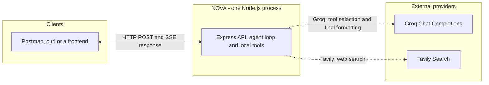
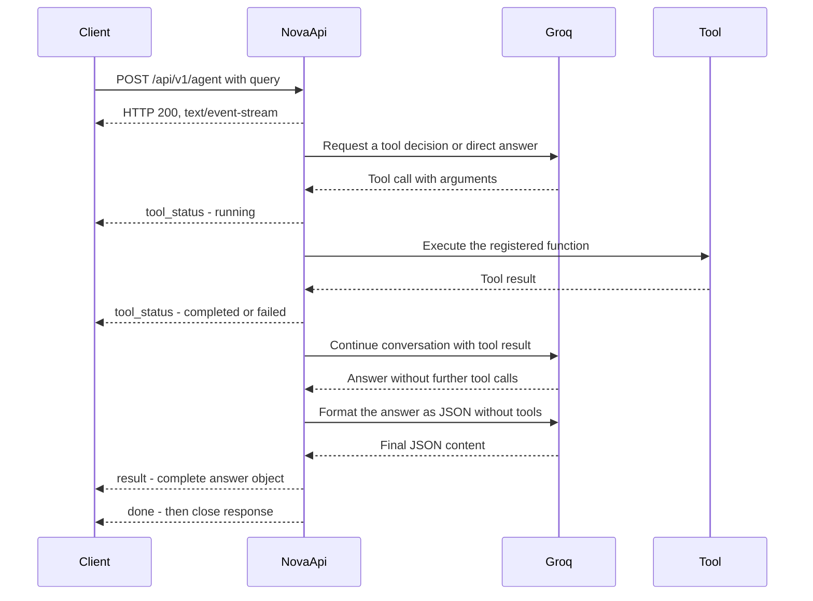

# NOVA AI Agent API

**A tool-using AI agent with live execution updates and structured final answers.**


NOVA is a Node.js and Express API powered by Groq. It can search the web through
Tavily, perform calculations, and look up the current date and time. Clients see
what the agent is doing through Server-Sent Events (SSE), then receive the complete
final answer as a structured JSON payload.

```text
Query -> Tool running -> Tool completed -> Final answer -> Done
```

Each request starts a fresh conversation. The API is a backend building block
for assistants, research interfaces, and applications that need visible tool
execution.

## Contents

- [Features](#features)
- [Use cases](#use-cases)
- [Architecture](#architecture)
- [Request lifecycle](#request-lifecycle)
- [Technology stack](#technology-stack)
- [Requirements](#requirements)
- [Setup](#setup)
- [API](#api)
- [Available tools](#available-tools)
- [Project structure](#project-structure)
- [Adding a tool](#adding-a-tool)
- [Troubleshooting](#troubleshooting)
- [Development notes](#development-notes)
- [Contributing](#contributing)

## Features

- **Model-directed tool use:** Groq selects registered tools and uses their
  actual results to prepare an answer.
- **Live tool progress:** SSE events identify each tool call and report its
  `running`, `completed`, or `failed` status.
- **Structured final output:** One `result` event carries the complete answer
  with `success`, `message`, `data`, and `error` fields.
- **Web search:** Tavily retrieves up to five search results per tool call.
- **Local utilities:** Calculator and timezone-aware date/time tools run in the
  Node.js process without separate external services.
- **Bounded execution:** Up to eight model rounds, with tool failures returned
  to the model for recovery or explanation.
- **HTTP middleware:** Environment validation, request logging, security
  headers, request size limits, and an in-memory rate limiter.

## Use cases

These are examples of applications that can use the API; a frontend is not
included in this repository. Actual tool selection and ordering depend on the
model and the query.

| Use case | Example query | Agent behavior | Client experience |
| --- | --- | --- | --- |
| Research assistant | "Find the latest Node.js release and include the official source URL." | Search for current information and prepare a sourced response. | Show `Web searching…`, then render the answer and any sources. |
| Calculation assistant | "What is 15 percent of 240?" | Execute the calculator with the requested operands and operation. | Show `Calculating…`, then display the result. |
| Timezone lookup | "What is the current time in Asia/Kolkata?" | Look up the current date and time using the requested timezone. | Show `Checking date and time…`, then display the answer. |
| Multi-step assistant | "Check the current time in Asia/Kolkata and calculate 125 * 48." | Execute the necessary tools and combine their results. | Track each tool call by ID, then show one final response. |
| General question answering | "Explain what an API is in simple terms." | Answer directly when no tool is needed. | Receive the final `result` without tool status events. |

### Why SSE fits this workflow

A tool call may take time while searching or waiting for an external provider.
SSE lets the server report progress on the same HTTP response without requiring
the client to poll for updates. The frontend can show meaningful activity instead
of waiting silently for the final answer.

The current transport streams **execution events**. Answer typing or token
streaming is not enabled: the final answer arrives once, in the `result` event.
The server sends factual tool activity, not the model's private reasoning.

## Architecture



The Express service validates the query and opens the SSE response. The agent
builds the conversation, requests model decisions, and dispatches tool calls
through a registry. Calculator and date/time operations execute locally; web
search uses Tavily. No database or persistent conversation store is used.

## Request lifecycle

The diagram shows a successful request that uses one tool. The selection and
execution steps can repeat across multiple rounds before the final answer.



If no tool is needed, the tool execution steps are skipped. If agent execution
throws, the server sends `app_error` and closes the stream. An individual tool
failure is sent back to the model and does not automatically end the request.

These diagrams use Mermaid code blocks, which
[GitHub renders in Markdown](https://docs.github.com/en/get-started/writing-on-github/working-with-advanced-formatting/creating-diagrams).

## Technology stack

| Layer | Technology | Responsibility |
| --- | --- | --- |
| Runtime | Node.js and JavaScript ES modules | HTTP server and local tool execution |
| HTTP API | Express 5 | Routing, middleware, and response lifecycle |
| Model provider | Groq SDK | Tool selection, answer generation, and JSON formatting |
| Search provider | Tavily SDK | Web search results |
| Event transport | Server-Sent Events | Tool progress and final result delivery |
| Configuration | dotenv and Zod | Environment loading and startup validation |
| Middleware | Helmet, CORS, express-rate-limit, pino-http | Headers, cross-origin access, rate limits, and logging |

## Requirements

- Node.js 20 or later and npm.
- A Groq API key and a model ID that supports tool calling and JSON object output.
- A Tavily API key for web search. This key is required at startup even when a
  query does not need search.

## Setup

Install the dependencies from the project directory:

```sh
npm ci
```

Create a `.env` file in the project root with the following settings, replacing
the placeholder values:

```dotenv
NODE_ENV=development
PORT=3000
GROQ_API_KEY=your_groq_api_key
GROQ_MODEL=your_groq_model_id
TAVILY_API_KEY=your_tavily_api_key
```

| Variable | Required | Default | Purpose |
| --- | --- | --- | --- |
| `NODE_ENV` | No | `development` | Accepts `development`, `production`, or `test`. |
| `PORT` | No | `3000` | HTTP port, from 1 to 65535. |
| `GROQ_API_KEY` | Yes | None | Authenticates Groq requests. |
| `GROQ_MODEL` | Yes | None | Model used for tool selection and final JSON formatting. |
| `TAVILY_API_KEY` | Yes | None | Authenticates Tavily web searches. |

Environment configuration is validated on startup. Missing required values or
invalid settings stop the process. `.env` files are ignored by Git;
`.env.example` is kept trackable.

Start the development server with automatic restarts:

```sh
npm run dev
```

To run without the development watcher:

```sh
node src/app.js
```

The default server address is `http://localhost:3000`. Setup is complete when
`GET /api/v1/health` returns HTTP `200`. Then test an agent query using one of the
SSE examples below to verify provider access and final answer delivery.

## API

| Method | Endpoint | Response |
| --- | --- | --- |
| `GET` | `/api/v1/health` | JSON server health response |
| `POST` | `/api/v1/agent` | SSE stream for a valid query; HTTP error response for rejected requests |

### Health check

`GET /api/v1/health`

```sh
curl http://localhost:3000/api/v1/health
```

```json
{
  "success": true,
  "message": "Web Search Agent API is running"
}
```

This endpoint checks that the HTTP server is running; it does not test the
external providers.

### Ask the agent

`POST /api/v1/agent`

Send a JSON body with a non-empty string named `query`:

```json
{
  "query": "What is 15 percent of 240?"
}
```

Valid queries receive an HTTP `200` response with
`Content-Type: text/event-stream; charset=utf-8`. The response stays open while
the agent works. It contains named events with JSON data, separated by a blank
line. It is not a single JSON response, and the final answer is not streamed
token by token.

### Test SSE in PowerShell

Start the server with `npm run dev`, then open a second terminal in the project
directory and run:

```powershell
$body = '{"query":"Use calculate to calculate 125 * 48 and give the final answer."}'
$body | curl.exe -N -i -X POST "http://localhost:3000/api/v1/agent" -H "Content-Type: application/json" -H "Accept: text/event-stream" --data-binary '@-'
```

Use `curl.exe` explicitly in PowerShell. `-N` disables output buffering so events
appear as they arrive; `-i` displays the response headers. Piping the body through
standard input avoids command-line JSON quoting issues. Replace `3000` if your
server uses a different port.

An illustrative event sequence (IDs and answer wording may vary):

```text
event: tool_status
data: {"id":"call_123","tool":"calculate","status":"running","message":"Calculating…"}

event: tool_status
data: {"id":"call_123","tool":"calculate","status":"completed","message":"calculate finished"}

event: result
data: {"success":true,"message":"125 × 48 = 6000.","data":null,"error":null}

event: done
data: {"completed":true}

```

### SSE event contract

| Event | Data | Meaning |
| --- | --- | --- |
| `tool_status` | `id`, `tool`, `status`, `message` | An actual tool call started or finished. `status` is `running`, `completed`, or `failed`. |
| `result` | Final answer object | The complete answer; display its `message` and any structured `data`. |
| `done` | `{"completed":true}` | Agent execution returned and the final result was sent. The server then closes the response. |
| `app_error` | `{"message":"Failed to execute AI agent."}` | Agent execution failed. The server closes the response without sending `result` or `done`. |

Use the tool call `id` to update the same UI entry from `running` to `completed`
or `failed`. A tool can run more than once, with a different ID for each call.
A failed tool is reported back to the model, which may recover or explain the
failure in its final answer. Tool completion alone does not mean the final
answer is ready; model processing and JSON formatting still need to finish.

If no tool is needed, the response can contain only `result` followed by `done`.
Tool selection depends on the model, so not every query produces tool events.

While the connection is open, the server sends an SSE comment every 15 seconds:

```text
: ping

```

This is a heartbeat, not an application event. Ignore comment lines when parsing
the stream. An unexpected disconnect before `done` or `app_error` means the
client has not received a complete execution outcome.

### Final answer format

The JSON payload inside the `result` event follows this format:

```json
{
  "success": true,
  "message": "15 percent of 240 is 36.",
  "data": { "result": 36 },
  "error": null
}
```

The model is instructed to return `success`, `message`, `data`, and `error`.
`data` can be an object, array, or `null`, and may include sources, clarification
details, or partial results. The application parses the final JSON but does not
validate it against the response schema at runtime, so its contents can vary.
`done.completed` indicates that execution returned; inspect `result.success`
and `result.error` to determine whether the requested task succeeded.

### Test SSE in Postman

1. Create an HTTP request with method **POST** and URL
   `http://localhost:3000/api/v1/agent`.
2. Set `Content-Type: application/json` and `Accept: text/event-stream` headers.
3. Select **Body > raw > JSON** and enter:

   ```json
   {
     "query": "Use calculate to calculate 125 * 48 and give the final answer."
   }
   ```

4. Click **Send** and inspect the SSE messages in the response area.
5. Wait for `result` and `done`, then open the **`result` event** to see the final
   answer. The `done` event only contains a completion flag.

If only tool status is visible, check the rest of the event list and any active
search or filter. If an `app_error` event appears, check the server terminal for
the underlying error. If the request remains open, the agent may still be
waiting for the model or a tool; heartbeat comments do not contain an answer.

Postman's [SSE response documentation](https://learning.postman.com/latest-v-12/docs/use/send-requests/response-data/responses#server-sent-events)
describes inspecting event messages.

### Browser clients

Use `fetch()` with method `POST` and a JSON body, then read `response.body` as a
stream. Native `EventSource` does not support this endpoint's POST body. Do not
call `response.json()` on a successful SSE response.

Buffer incoming text until a complete blank-line event boundary is available;
a network chunk can contain part of an event or multiple events. Parse each
event's `data` as JSON, update progress for `tool_status`, and render the complete
answer for `result`. Ignore heartbeat comments and treat `app_error` as terminal.

### HTTP status and errors

| HTTP status | Meaning |
| --- | --- |
| `200` | The SSE connection opened. Inspect `result` or `app_error` for the execution outcome. |
| `400` | The query is missing, blank, or not a string, or the request contains invalid JSON. |
| `413` | The JSON request body exceeds 16 KB. |
| `429` | The client exceeded 60 requests per minute across `/api` routes, including health checks. |
| `500` | A server error occurred before response headers were sent. |

Errors before streaming starts use regular HTTP responses, not SSE. Error bodies
can differ by handler. For example, an invalid query returns HTTP `400` with
`{"success":false,"message":"Search query is required"}`.

After SSE headers are sent, the HTTP status cannot change. Agent execution
errors are sent as `app_error` events on the existing HTTP `200` response. HTTP
`200` alone does not confirm that the task succeeded.

## Available tools

| Tool | Inputs | Behavior |
| --- | --- | --- |
| `webSearch` | `query` | Searches Tavily with up to five results. |
| `get_current_datetime` | Optional `timezone` | Returns date/time information; defaults to `Asia/Kolkata`. Accepts IANA timezone names. |
| `calculate` | `operation`, `a`, `b` | Supports `add`, `subtract`, `multiply`, `divide`, `percentage`, `power`, and `modulus`. |

The percentage operation computes `a * b / 100`. Calculator inputs must be
finite numbers; division and modulus by zero return an error.

The agent chooses whether to call tools and executes requested calls in sequence.
It allows up to eight model rounds to produce an answer, then uses a separate
Groq request to format that answer as JSON. Failure to finish within the limit
results in an execution error.

## Project structure

```text
src/
  app.js                        Express setup and server entry point
  config/env.js                 Environment validation
  ai/groq.client.js             Groq client configuration
  agents/agent.js               Tool-calling loop and final formatting
  agents/prompt.js              Prompts and response schema
  routes/ai.route.js            Agent endpoint routing
  services/ai.service.js        Query validation, SSE events, and heartbeats
  middlewares/error.middleware.js  Shared error handler
  tools/registry.js             Tool schemas and execution dispatch
  tools/search.tool.js          Tavily web search
  tools/datetime.tool.js        Date and timezone lookup
  tools/calculator.tool.js      Arithmetic operations
  utils/sse.js                  SSE headers, event formatting, and closing
```

## Adding a tool

1. Create the function schema and implementation in `src/tools/`.
2. Import both into `src/tools/registry.js`.
3. Add the schema to the `tools` array and the implementation to `toolRegistry`.
   The schema's function name must match its registry key.
4. Add a label to `toolLabels` in `src/agents/agent.js` to customize its running
   message. Otherwise, the agent uses `Running <tool>…`.
5. Test a successful call and a failure. Confirm that tool status events are
   followed by the expected final `result` and `done` events.

Handlers can be synchronous or asynchronous. A handler can return
`{ success: false, error: "..." }` or throw an error to report failure. The agent
passes that outcome to the model and emits a failed status. Progress events are
emitted around registry execution, so each new tool uses the same SSE flow.

## Troubleshooting

| Symptom | What to check |
| --- | --- |
| Server exits during startup | Check the environment validation output. Both provider keys and `GROQ_MODEL` must be non-empty. |
| Connection refused | Start the server and confirm the hostname and configured `PORT`. |
| HTTP `400` before any events | Send valid JSON with a non-empty string named `query`. |
| Tool events appear but no answer is visible in Postman | Wait for execution to finish, clear any response filters, and open the `result` event. `tool_status` and `done` do not contain the final answer. |
| `app_error` appears after HTTP `200` | Inspect the server terminal for the underlying provider, JSON formatting, or execution-limit error. SSE headers were already sent. |
| Events appear all at once | Use `curl.exe -N` or an SSE-capable client. Check whether a reverse proxy buffers the response. |
| `get_current_datetime` fails | Use an IANA timezone such as `Asia/Kolkata`, `UTC`, or `America/New_York`. |
| HTTP `429` | The current in-memory limit is 60 requests per minute across `/api`, including health checks. Wait for the rate-limit window to reset. |
| Only heartbeat comments arrive | The connection is open, but the model or tool has not finished. Check server logs if the request does not complete. |
| A browser client cannot parse the response | Read the SSE stream incrementally; do not treat the whole response as one JSON object. |

## Development notes

The server uses Helmet, CORS, HTTP request logging, a 16 KB JSON body limit, and
an in-memory API rate limiter. CORS currently allows all origins, and the API has
no authentication layer.

No automated test suite is configured yet. `npm test` is a placeholder that exits
with an error. Use the health check to verify local startup, then use the SSE
testing steps above with valid provider credentials to check tool events and
the final `result` followed by `done`.

### Current scope

| Area | Current behavior |
| --- | --- |
| Conversation state | Request-scoped messages; no history across requests |
| Client interface | Backend API; no bundled frontend |
| Streaming | Tool progress events and one complete final answer |
| Final response validation | JSON parsing; the response schema is prompt-driven and not validated at runtime |
| Tool execution | Sequential execution of model-requested calls |
| Connection cleanup | Heartbeat timer is cleared when the response closes; disconnecting does not cancel in-flight provider or tool work |
| Event replay | No event IDs, resume support, or automatic execution recovery |
| Rate limiting | In-memory state scoped to the running server process |

When hosting behind a reverse proxy, preserve `text/event-stream`, disable
response buffering for the agent route, and allow enough time for model and tool
requests to finish. The SSE helper already sends `Cache-Control: no-cache,
no-transform` and `X-Accel-Buffering: no`; the proxy must honor the configuration.

## Contributing

Keep changes focused on the agent, registered tools, or event contract. Describe
the problem and resulting behavior in a pull request, include the validation you
ran, and update this README when public API behavior changes.

Before submitting, run the server, check the health endpoint, and verify an SSE
request through to its final `result` and `done`. For tool changes, also exercise
a failure path. Use placeholders in examples and keep local provider credentials
in `.env`, which is excluded by `.gitignore`.
